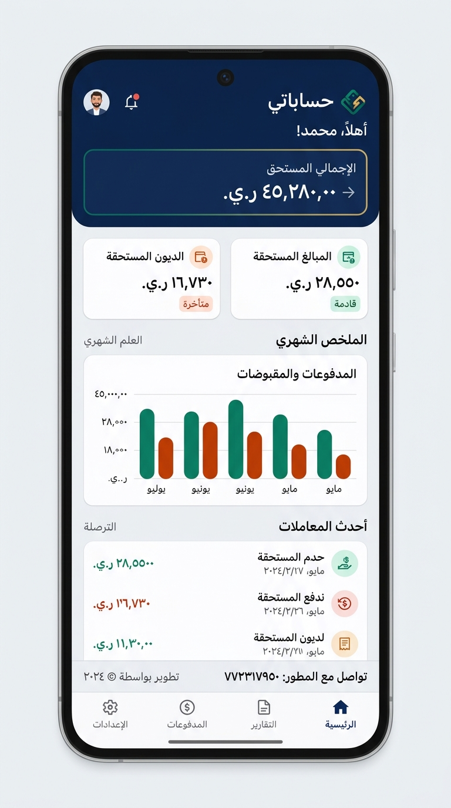
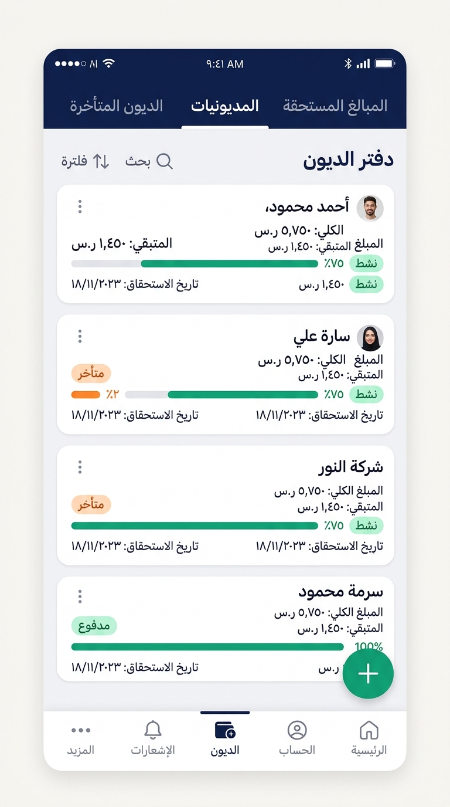
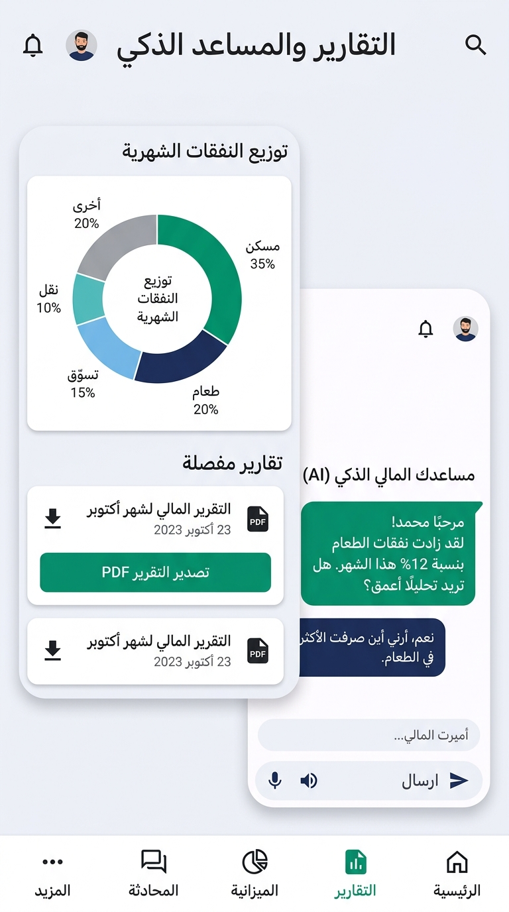

<div dir="rtl" align="center">


# حساباتي | HISABATI
### كل ديونك ومستحقاتك في مكان واحد

[-0E9F6E?style=for-the-badge&logo=android&logoColor=white)](releases/hisabati-v1.0-android.apk?raw=true)
[](app/build.gradle.kts)
[](app/src/main/java/com/example/ui/theme/Theme.kt)
[](app/src/main/res/values/strings.xml)

**تطوير وتنفيذ: عمل أنما سوفت — للتواصل والدعم المباشر: [`772317950`](tel:772317950)**

[⬇️ تحميل حزمة التثبيت المباشر APK](#download-apk) •
[📸 صور من التطبيق](#screenshots) •
[✨ المميزات الرئيسية](#features) •
[🏛️ البنية التقنية](#architecture) •
[🗄️ الخادم وقاعدة البيانات](#backend)

</div>

---

## نظرة عامة

**حساباتي (HISABATI)** هو نظام مالي عربي متكامل واحترافي لإدارة الديون الشخصية والتجارية، والمستحقات، والمدفوعات الجزئية والكاملة، وجدولة الأقساط، ومتابعة العملاء والموردين بدقة محاسبية عالية ودعم كامل للعمل دون إنترنت (**Offline-First**) مع مزامنة سحابية آمنة.

تم تصميم التطبيق بهوية **Premium Fintech UI** باللغة العربية الكاملة واتجاه **RTL بنسبة 100%** في جميع الشاشات والتقارير وملفات PDF، مع شريط تذييل (Footer) ثابت في كافة صفحات التطبيق يحمل توقيع **عمل أنما سوفت** ورقم التواصل المباشر **`772317950`** للانتقال الفوري إلى تطبيق المكالمات.

---

<a id="download-apk"></a>
## ⬇️ التحميل والتثبيت المباشر على هواتف Android

يمكنك تحميل حزمة التثبيت الجاهزة مباشرة على هاتفك من هذا المستودع عبر رابط التنزيل المباشر (`?raw=true`) أو من صفحة **GitHub Releases**:

| الحزمة | الإصدار | الحجم | المتطلبات | التحميل المباشر |
| :--- | :---: | :---: | :---: | :--- |
| **`hisabati-v1.0-android.apk`** | `v1.0` | ~30 MB | Android 7.0+ (API 24+) | [**⬇️ تحميل APK الآن (رابط مباشر)**](releases/hisabati-v1.0-android.apk?raw=true) • [صفحة الملف](releases/hisabati-v1.0-android.apk) |

> ملف التحقق من السلامة (Checksum): [`releases/SHA256SUMS.txt`](releases/SHA256SUMS.txt)

### خطوات التثبيت على الجوال
1. اضغط على [**⬇️ تحميل APK الآن (رابط مباشر)**](releases/hisabati-v1.0-android.apk?raw=true) لبدء تنزيل ملف **`hisabati-v1.0-android.apk`** مباشرةً (إذا كنت تتصفح من داخل تطبيق الجوال ولم يبدأ التنزيل، افتح صفحة المستودع في متصفح Chrome أو اضغط على [صفحة الملف](releases/hisabati-v1.0-android.apk) ثم اختر **View raw** / **Download**).
2. بعد انتهاء التنزيل، افتح الملف من مدير الملفات أو الإشعارات، وإذا طُلب منك فعّل خيار **"السماح بتثبيت التطبيقات من هذا المصدر"**.
3. اضغط **تثبيت (Install)** ثم افتح تطبيق **حساباتي**.

> **ملاحظة التوقيع:** الحزمة الجاهزة `hisabati-v1.0-android.apk` موقّعة بمفتاح التطوير المعتمد في المشروع للتثبيت الفوري والتشغيل المباشر على هواتف Android، بينما يستخدم إصدار الإنتاج لمتجر Google Play (`.aab`) مفاتيح التوقيع السرية عبر بيئة CI (`KEYSTORE_PATH` و`STORE_PASSWORD` و`KEY_PASSWORD`).

---

<a id="screenshots"></a>
## 📸 لقطات من واجهة التطبيق

<div align="center">

| لوحة التحكم والمؤشرات المالية | إدارة الديون والمستحقات والأقساط | التقارير العربية والمساعد الذكي |
| :---: | :---: | :---: |
|  |  |  |

</div>

---

<a id="features"></a>
## ✨ المميزات الرئيسية

### 1. لوحة تحكم مالية تفاعلية (Dashboard)
- عرض **9 مؤشرات مالية فورية**: إجمالي المستحق لي، إجمالي المستحق عليّ، صافي المركز المالي، إجمالي المحصّل، إجمالي المسدّد، الديون المتأخرة، الديون القريبة من الاستحقاق، عدد الأشخاص، وعدد المعاملات.
- رسوم بيانية تفاعلية (`Compose Canvas`) لحركة الديون والتحصيل خلال آخر 6 أشهر ونسبة المستحقات إلى الالتزامات.
- إجراءات سريعة لإضافة دين أو تسجيل دفعة خلال ثوانٍ.

### 2. دقة محاسبية والعمل متعدد العملات
- معالجة جميع المبالغ المالية عبر وحدات صغرى (`Long` minor units) و`BigDecimal` عبر [`MoneyMath`](app/src/main/java/com/example/domain/model/MoneyMath.kt) دون استخدام `Float` أو `Double` لمنع أي أخطاء تقريب.
- دعم العملات الافتراضية (**SAR, YER, USD, AED, EGP**) مع إمكانية إضافة عملات مخصصة وتحديث أسعار الصرف.

### 3. إدارة الديون، الأقساط، والدفعات
- تصنيف واضح للديون (**مستحقة لي** / **مستحقة عليّ** / **المتأخرة**) مع فلاتر الحالة والعملة.
- توليد تلقائي لجدول الأقساط عند إنشاء الدين مع إمكانية إعادة الجدولة وحفظ سبب التعديل في سجل التدقيق.
- تسجيل دفعات جزئية أو كاملة أو تسوية مع خصم متفق عليه، مع **منع السداد الزائد** وحماية العمليات بمفاتيح منع التكرار (`idempotencyKey`).
- إرفاق صور الفواتير والمستندات عبر Android Photo Picker الآمن دون طلب أذونات تخزين واسعة.

### 4. معمارية Offline-First والمزامنة السحابية
- حفظ فوري لجميع العمليات في قاعدة البيانات المحلية **Room** مع طابور مزامنة (`sync_outbox`).
- مزامنة تلقائية في الخلفية عبر **WorkManager** عند توفر الإنترنت مع **Cloud Firestore** المحمي بقواعد أمان Zero-Trust.
- تصدير واستعادة النسخ الاحتياطية كاملة بصيغة **JSON** عبر Storage Access Framework (SAF).

### 5. التقارير العربية RTL (PDF & Excel)
- توليد تقارير وكشوف حساب وإيصالات سداد بصيغة **PDF عربي RTL** منسق احترافياً عبر `PdfDocument` و`StaticLayout` وخط `IBM Plex Sans Arabic`.
- تصدير جداول متوافقة مع Microsoft Excel بالعربية (**CSV UTF-8 BOM**).
- الطباعة المباشرة عبر `PrintManager` والمشاركة الفورية عبر `FileProvider`.

### 6. التذكيرات، واتساب، و SMS
- تذكيرات مجدولة محلياً في الخلفية عبر `ReminderWorker` و`BootReceiver`.
- قوالب رسائل عربية قابلة للتعديل مع متغيرات تلقائية (`{الاسم}`, `{المبلغ}`, `{المتبقي}`, `{التاريخ}`, `{رقم_الإيصال}`).
- إرسال فوري عبر تطبيق **واتساب** أو **SMS** على الهاتف، أو عبر خادم **WhatsApp Business Cloud API** و **SMS Gateway** المرفق.

### 7. المساعد المالي الذكي (Firebase AI Logic)
- استعلامات ذكية بالعربية حول الأرصدة والمتأخرات وأكثر العملاء مديونية وملخص الشهر، محمية بمفتاح **موافقة الخصوصية الصريح** قبل التحليل.

### 8. الأمان والصلاحيات (RBAC) وتذييل أنما سوفت الثابت
- قفل التطبيق برمز **PIN** (SHA-256 + Salt) والفتح بالبصمة الحيوية (`BiometricPrompt`).
- وضع **الحساب الشخصي / التجاري** مع إدارة أعضاء الفريق بصلاحيات دقيقة (`OWNER`, `MANAGER`, `STAFF`, `VIEWER`).
- سجل تدقيق (`Audit Logs`) غير قابل للتعديل يوثق جميع الحركات المالية والتعديلات.
- **شريط فوتر احترافي ثابت في جميع الصفحات:** يظهر في كافة شاشات التطبيق نص **«عمل انما سوفت»** وزر الاتصال المباشر **`772317950`** لفتح تطبيق المكالمات فوراً.

---

<a id="architecture"></a>
## 🏛️ البنية التقنية والمعمارية

```text
app/src/main/java/com/example/
├── auth/            # مصادقة Google عبر Credential Manager
├── data/
│   ├── local/       # Room Entities, DAOs, HisabatiDatabase, DataStore Preferences
│   ├── remote/      # FirestoreCloudDataSource, ErrorHandler, MessagingRelayApi
│   └── repository/  # HisabatiRepository (Offline-First + Outbox), AiFinancialRepository
├── domain/model/    # MoneyMath (BigDecimal/Long), DomainEnums, CloudModels
├── export/          # ArabicReportExporter (PDF RTL, CSV UTF-8 BOM, PrintManager)
├── messaging/       # ExternalMessagingHelper (WhatsApp, SMS, Dialer)
├── notifications/   # ReminderWorker, OfflineSyncWorker, BootReceiver
├── security/        # Firebase App Check (Debug & reCAPTCHA)
└── ui/
    ├── components/  # FintechComponents & AnmaSoftFooterBar
    ├── navigation/  # Navigation Compose Adaptive Shell (NavigationBar / Rail)
    ├── screens/     # 30 شاشة عربية متكاملة RTL
    ├── theme/       # Royal Navy & Emerald Design System + IBM Plex Sans Arabic
    └── viewmodel/   # HisabatiViewModel (StateFlow Metrics & Flows)
```

---

## 🛠️ البناء والتشغيل من المصدر

### بناء تطبيق Android
```bash
# التحقق من الاختبارات الشاملة (المنطق المالي + Room + قواعد Firestore)
gradle :app:testDebugUnitTest

# بناء حزمة التثبيت APK
gradle :app:assembleDebug
```
يتم إنشاء ملف الـ APK في:
`app/build/outputs/apk/debug/app-debug.apk`

كما يحتوي المستودع على مسار عمل تلقائي في [`.github/workflows/android-release.yml`](.github/workflows/android-release.yml) لبناء ونشر حزمة APK تلقائياً في **GitHub Releases** عند دفع أي وسْم إصدار (`git tag v1.0.0 && git push --tags`) أو تشغيله يدوياً من تبويب **Actions -> Run workflow**.

---

<a id="backend"></a>
## 🗄️ الخادم الخلفي وقاعدة البيانات (PostgreSQL)

يضم المستودع خادماً خلفياً متكاملاً في [`backend/`](backend/) وترحيل قاعدة بيانات علائقية مكون من **18 جدولاً** في [`backend/migrations/001_initial_schema.sql`](backend/migrations/001_initial_schema.sql):

```bash
cd backend
cp .env.example .env
npm install
npm run migrate
npm run build && npm start
```

للمزيد من التفاصيل راجع الأدلة المتوفرة في [`docs/`](docs/):
- [`docs/API_DOCS.md`](docs/API_DOCS.md) — توثيق نقاط النهاية البرمجية (REST API)
- [`docs/DATABASE_AND_BACKEND_GUIDE_AR.md`](docs/DATABASE_AND_BACKEND_GUIDE_AR.md) — دليل قاعدة البيانات والخادم
- [`docs/TESTING_GUIDE_AR.md`](docs/TESTING_GUIDE_AR.md) — دليل الاختبارات وضمان الجودة

---

<div dir="rtl" align="center">

### 📞 الدعم والتطوير
**عمل أنما سوفت (Anma Soft)**
للطلبات الخاصة والدعم الفني: [**`772317950`**](tel:772317950)

</div>
